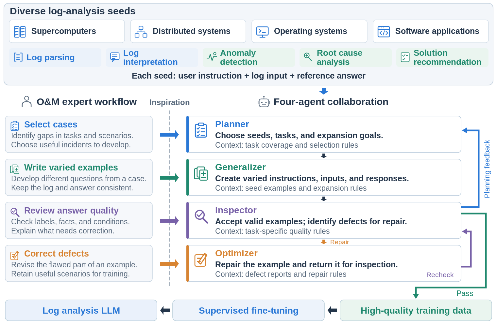

<div align="center">

# LogRefine

### Improving Instruction Data Quality for Log Analysis<br>through Multi-Agent Collaboration

**Four agents. Two feedback loops. Better log instruction data.**


[Overview](#-overview) · [Dataset](#-dataset) · [Quick start](#-quick-start) · [Role prompts](#-role-prompts) · [Citation](#-citation)

</div>

---

## 📣 Overview

Synthetic instruction data helps LLMs learn log analysis, but incorrect answers,
missing facts, and repeated scenarios can limit what they learn. **LogRefine**
improves data at two levels: coverage and diversity across the dataset, and
correctness and completeness within each example.

Inspired by how operations and maintenance (O&M) experts prepare training data,
LogRefine assigns this work to a **Planner**, **Generalizer**, **Inspector**, and
**Optimizer**. Two feedback loops connect planning, generation, inspection,
and repair.

<div align="center">

</div>

- **Plan for coverage.** Select seeds and expansion goals using task coverage and inspection findings.
- **Generalize for diversity.** Develop varied questions, conditions, and scenarios from log seeds.
- **Inspect for quality.** Check task validity, technical correctness, evidence support, task completeness, and training clarity.
- **Repair useful cases.** Correct defects while retaining valuable scenarios, then inspect the revised examples again.

The **sample repair loop** connects Inspector → Optimizer → Inspector, with up
to two repair rounds. The **dataset planning loop** returns inspection findings
and coverage summaries to the Planner for the next batch.

This repository contains the **3,000-example dataset**, **four role prompts**,
and **data-construction code**.

---

## 🗂️ Dataset

The dataset provides **600 examples for each of five log analysis tasks**.
Together, these tasks cover the path from reading logs to diagnosing failures
and recommending operational actions.

| Task | Code | Examples | Training goal |
|---|---|---:|---|
| Log parsing | `Parsing` | 600 | Extract templates and variable fields |
| Anomaly detection | `AD` | 600 | Identify abnormal behavior in logs |
| Log interpretation | `Interpretation` | 600 | Explain events and their meaning |
| Root cause analysis | `RCA` | 600 | Diagnose causes using log evidence |
| Solution recommendation | `SR` | 600 | Recommend actions for the reported problem |
| **Total** | | **3,000** | |

**[Download the dataset](data/train.jsonl)** · **[Data format and sources](data/README.md)**

Each JSONL record contains `instruction`, `input`, and `output`, with optional
`reasoning` and fields identifying its task and source seed.

```python
import json

with open("data/train.jsonl", encoding="utf-8") as f:
    examples = [json.loads(line) for line in f if line.strip()]

example = examples[0]
print(example["instruction"])
print(example["input"])
print(example["output"])
```

---

## 🚀 Quick start

### 1. Install

Use **Python 3.9 or later**.

```bash
git clone https://github.com/lunyiliu/LogRefine.git
cd LogRefine
pip install -e .
```

### 2. Configure your model

Set an OpenAI-compatible chat-completions endpoint. See
[`config.example.env`](config.example.env) for optional settings.

```bash
export LOGREFINE_API_BASE=https://your-host/v1
export LOGREFINE_API_KEY=your-api-key
export LOGREFINE_MODEL=your-model-id
```

### 3. Construct instruction data

The example below uses the supplied demonstration seeds. Replace `--seeds`
with your own JSONL file to process your log scenarios.

```bash
python -m lr.cli run \
  --seeds examples/demo_seeds.jsonl \
  --targets '{"AD":2,"Interpretation":2,"Parsing":2,"RCA":2,"SR":2}' \
  --batch-limit 5 --max-rounds 4 --wall-sec 900 \
  --parsing-task-constraint --ad-task-constraint \
  --sr-task-constraint --rca-task-constraint \
  --out-dir output
```

Each seed supplies a task, instruction, log input, reference answer, and source
identifier. [`examples/demo_seeds.jsonl`](examples/demo_seeds.jsonl) shows the
input format. The run stops when it reaches its targets or the configured limits;
`summary.json` reports the resulting counts.

| Output | Contents |
|---|---|
| `train.jsonl` | Accepted instruction examples for training |
| `audit.jsonl` | Inspection findings, edits, and route decisions |
| `summary.json` | Task counts and run statistics |
| `pipeline_state.json` | Saved progress and feedback for resumed runs |

---

## 🧩 Role prompts

Every role receives the [shared O&M knowledge](lr/prompts/v1/shared.md), its role
prompt, and a JSON context packet. Shared rules cover parsing boundaries,
request-level recovery, causal evidence, operational prerequisites, and
meaningful scenario variation.

| Role | Prompt | Main context |
|---|---|---|
| Planner | [Planning and coverage](lr/prompts/v1/planner.md) | Seed inventory, coverage counts, inspection findings |
| Generalizer | [Seed expansion](lr/prompts/v1/generalizer.md) | Plan, log seeds and answers, incident evidence, nearby examples |
| Inspector | [Quality inspection](lr/prompts/v1/inspector.md) | Candidate, reference evidence, task rules, duplicate checks |
| Optimizer | [Sample repair](lr/prompts/v1/optimizer.md) | Candidate, defect report, allowed edits, diagnostic evidence |

<details>
<summary><b>Inspector dimensions and response fields</b></summary>

| Quality dimension | JSON key |
|---|---|
| Task validity | `task_validity` |
| Technical correctness | `correctness` |
| Evidence support | `grounding` |
| Task completeness | `completeness` |
| Training clarity | `usability` |

The Inspector uses `pass`, `fail`, or `unknown` for each dimension. `novelty`
records a separate diversity check. [`lr/roles.py`](lr/roles.py) validates role
responses, and [`manifest.json`](lr/prompts/v1/manifest.json) stores prompt checksums.

</details>

---

## 📁 Repository layout

```text
LogRefine/
├── assets/                  # Framework figure
├── data/
│   ├── train.jsonl          # 3,000 log instruction examples
│   └── README.md           # Data fields and sources
├── examples/                # Demonstration seeds
├── lr/
│   ├── prompts/v1/         # Shared knowledge and four role prompts
│   ├── pipeline.py         # Role coordination and feedback loops
│   ├── roles.py            # Prompt loading and response validation
│   ├── tools.py            # Task, source, and coverage checks
│   ├── seed_pool.py        # Seed loading and deduplication
│   ├── source_groups.py    # Source grouping
│   ├── client.py           # OpenAI-compatible model client
│   └── cli.py              # Command-line interface
├── tests/                   # Pipeline and interface tests
├── config.example.env       # Model configuration
├── LICENSE
└── NOTICE.md                # Source attribution
```

## 🧪 Tests

```bash
python -m unittest discover -s tests -v
```

The tests cover role contracts, both feedback loops, repair, source checks,
dataset loading, and command-line execution. They use offline fixtures and a
local HTTP server, so they do not require a model API key.

## 📜 Citation

```bibtex
@misc{liu2026logrefine,
  title = {LogRefine: Improving Instruction Data Quality for Log Analysis through Multi-Agent Collaboration},
  author = {Liu, Yilun and Tao, Shimin and Zhang, Li and Meng, Weibin and Zhang, Can and Zheng, Xiaolong and Wei, Daimeng and Zhang, Shenglin and Sun, Yongqian},
  year = {2026},
  url = {https://github.com/lunyiliu/LogRefine}
}
```

## Source attribution

See [`LICENSE`](LICENSE) for the code license and [`NOTICE.md`](NOTICE.md) for
source attribution and dataset terms.
